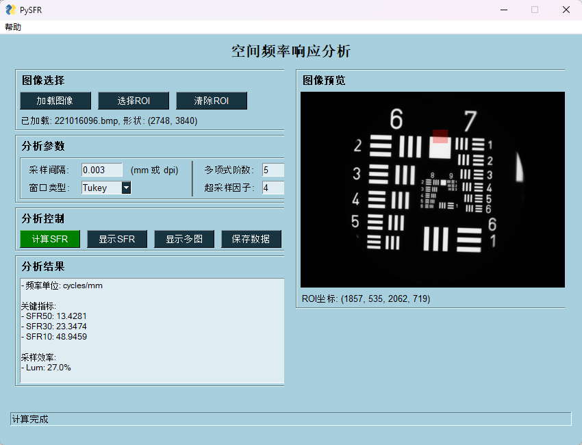
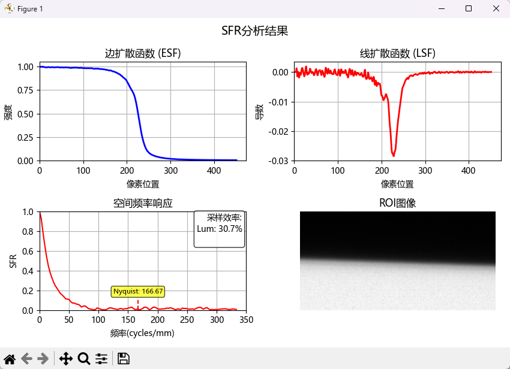

[简体中文](README.md) | **English**

# PySFR - Python Spatial Frequency Response Analysis Tool

A Python implementation ported from MATLAB's `sfrmat5.m` for calculating Spatial Frequency Response (SFR) of imaging systems. Supports both command-line and GUI modes.



## Project Structure

```
PySFR/
├── src/                # Source code
│   ├── PySFR.py        # Core SFR calculator class
│   ├── slantedgeMTF.py # Slanted-edge MTF computation
│   └── test_sfr_comparison.py # SFR comparison test
├── docs/               # Documentation
│   ├── 算法比较报告.md # Algorithm comparison report (Chinese)
│   └── draft-email-to-peter-burns.md # Draft email to Peter Burns
├── images/             # Test images
│   ├── Plan N 10x-1.bmp
│   ├── Test_edge1.tif
│   └── Test_edge1_mono.tif
├── data/               # Data output directory
│   ├── Plan N 10x-1.xlsx
│   └── Test_edge1.xlsx
├── ref/                # Original MATLAB sfrmat5.m reference
├── GUI.py              # FreeSimpleGUI interface (main program)
├── README.md           # Documentation (Chinese)
├── README.en.md        # Documentation (English)
└── LICENSE             # MIT License
```

## Changelog

### v1.0.2 (2026-06-05)
**Code cleanup and refactoring**

#### Refactoring
- Removed all Tkinter dependencies from PySFR.py (tkinter, filedialog, RectangleSelector)
- Removed unused imports (interp1d, curve_fit), streamlined dependencies
- Replaced dead `io != 1` branch with explicit error message guiding users to GUI.py
- Extracted `_update_preview()` method in GUI.py, eliminating three duplicate image preview code blocks (net −126 lines)
- Removed unused logging import from GUI.py
- Updated `io` parameter documentation in README code examples

### v1.0.1 (2026-04-22)
**Bug fix release**

#### Fixes
- Fixed image loading in GUI to support Chinese file path names
- Optimized image loading mechanism: replaced `cv2.imread` with `np.fromfile` + `cv2.imdecode` to handle Chinese paths

### v1.0.0 (2026-04-20)
**Full feature release**

#### Core features
- Complete Python port of MATLAB's sfrmat5.m algorithm
- Independent RGB and luminance channel analysis
- 4× oversampling for improved measurement accuracy
- Window function selection (Tukey, Hamming)

#### GUI features
- Modern FreeSimpleGUI user interface
- Interactive ROI selection tool
- Real-time result display and chart plotting
- About menu showing version info, author, and contact
- Chinese UI — all dialogs and button labels localized

#### Algorithm optimizations
- Precise edge detection and weighted fitting algorithm
- Fixed ESF boundary artifacts
- Optimized edge projection algorithm for higher accuracy
- Nyquist frequency annotation based on detector sampling interval
- Consistent frequency units

#### Data export
- Excel format data export
- Comprehensive logging and error handling
- Cross-platform compatibility (Windows/Linux/macOS)

## Overview




### Key Features

- **Multi-channel support**: Independent RGB and luminance channel analysis
- **Edge detection**: Automatic edge detection and fitting
- **Oversampling**: 4× oversampling for higher measurement precision
- **Window functions**: Supports Tukey and Hamming windows
- **Modern GUI**: FreeSimpleGUI-based modern user interface
- **ROI selection**: Interactive region-of-interest selection
- **Data export**: Excel format data export
- **Detailed logging**: Comprehensive logging and error handling
- **Cross-platform**: Windows/Linux/macOS compatible
- **About menu**: Version info, author, and contact details
- **Nyquist annotation**: Accurate Nyquist frequency marking based on detector sampling interval
- **Real-time results**: MTF30/MTF10 and other key metrics displayed in real time

## Requirements

### Python Version
- Python 3.7 or later

### Dependencies
```bash
# Core dependencies
pip install numpy scipy matplotlib opencv-python

# GUI dependencies
pip install FreeSimpleGUI Pillow

# Optional: Excel export
pip install pandas openpyxl
```

### Key Dependencies
- `numpy`: Numerical computation and array operations
- `scipy`: Scientific computing (FFT, signal processing)
- `matplotlib`: Data visualization and charting
- `opencv-python`: Image I/O and processing
- `FreeSimpleGUI`: Graphical user interface
- `PIL` (Pillow): Image processing support
- `pandas`: Excel data export (optional)
- `openpyxl`: Excel file support (optional)

## Usage

### 1. GUI Mode (Recommended)

```bash
# Launch the GUI
python GUI.py
```

The GUI provides:
- Image file selection
- ROI selection
- Parameter configuration
- Real-time result display
- Data export

### 2. Programmatic Use (API)

```python
import numpy as np
from src.PySFR import SFRCalculator

# Create an SFR calculator instance
sfr = SFRCalculator()

# Non-GUI mode (direct data input)
image_data = np.array(...)  # Your image data
status, dat, e, sfr50, fitme, esf, nbin, del2, is_dpi = sfr.calculate_sfr(
    io=1,                    # io=1: non-GUI mode (io=0 deprecated, returns error)
    del_input=0.01,          # Sampling interval (mm)
    a=image_data,            # Image data
    npol=5,                  # Polynomial fitting order
    wflag=0                  # Window function (0=Tukey, 1=Hamming)
)

# Process results
if status == 0:  # Success
    print(f"SFR calculation succeeded - SFR50: {sfr50}")
    # Use dat, esf, fitme, etc.
else:
    print("SFR calculation failed")
```

### 3. Test Program

The project includes a test program for algorithm validation:

```bash
# Run SFR comparison test
python src/test_sfr_comparison.py
```

Test program features:
- Compare SFR results from different algorithms
- Validate edge detection and fitting accuracy
- Test multi-channel processing capability

## Output Description

The function returns a tuple containing multiple results:

- `status`: Processing status (0=success, 1=failure)
- `dat`: SFR data matrix [frequency, R, G, B, Lum]
- `e`: Sampling efficiency array
- `sfr50`: Frequency at which SFR = 50%
- `fitme`: Edge fitting parameters
- `esf`: Edge spread function data
- `nbin`: Binning factor
- `del2`: Oversampling interval
- `is_dpi`: DPI input mode flag

## Algorithm Overview

### 1. Edge Detection and Fitting
- 1D derivative-based edge detection
- Polynomial edge profile fitting
- Adaptive window function for edge localization

### 2. Edge Spread Function (ESF)
- Projection and binning convert 2D edge data to 1D ESF
- 4× oversampling improves spatial resolution

### 3. Line Spread Function (LSF)
- Differentiation of ESF yields LSF
- Window function applied to reduce spectral leakage

### 4. Modulation Transfer Function (MTF)
- Fourier transform of LSF yields MTF
- Discrete derivative response correction
- Normalization

## Test Images

The project includes several test images:

- `images/Plan N 10x-1.bmp`: Flat-field test image
- `images/Test_edge1.tif`: Edge test image
- `images/Test_edge1_mono.tif`: Single-channel edge test image

## Parameters

### Default Parameters
```python
# Luminance weights (R, G, B)
guidefweight = np.array([0.213, 0.715, 0.072])

# Polynomial fitting order
defnpol = 5

# Binning factor
nbin = 4

# Tukey window parameter
defalpha = 1.0
maxalpha = 1.0
minalpha = 0.5
```

### Tunable Parameters
- `npol`: Polynomial order for edge fitting (1–5)
- `wflag`: Window function (0=Tukey, 1=Hamming)
- `weight`: RGB-to-luminance conversion weights
- `alpha`: Tukey window shape parameter

## Logging and Debugging

The program uses Python's `logging` module for detailed runtime logs:

- Log level: INFO
- Output: console and `PySFR.log` file
- Encoding: UTF-8

## Comparison with MATLAB Version

### Similarities
- Core algorithm: pixel projection, window functions, edge fitting
- Input/output format
- Parameter settings and defaults
- Edge detection and fitting methods
- SFR computation pipeline

### Differences
- Python OOP implementation (SFRCalculator class)
- Improved error handling and logging
- Dual-mode interface (FreeSimpleGUI + CLI)
- Excel data export support
- Cross-platform compatibility
- Standalone ROI selection tool class
- Fixed ESF boundary artifacts
- Optimized edge projection for higher accuracy
- Modern FreeSimpleGUI interface
- Module renamed from sfrmat5.py to PySFR.py

## Applications

1. **Camera testing**: Evaluate image quality of camera systems
2. **Lens assessment**: Analyze lens resolution and contrast
3. **Image processing validation**: Test algorithm impact on image quality
4. **Scientific research**: Optical system and imaging quality studies

## Notes

1. **Image quality**: Use high-quality, uncompressed image files
2. **Edge contrast**: Edge contrast should exceed 20% for accurate results
3. **ROI selection**: Choose regions with well-defined edges
4. **Sampling interval**: Set pixel size or DPI correctly

## License

Ported from Peter Burns' MATLAB version `sfrmat5.m`.

Original MATLAB code copyright:
- Author: Peter Burns, pdburns@ieee.org
- Based on sfrmat4, adapted with polynomial edge fitting
- Last updated: February 27, 2023

## Authors and Contributors

- **Original MATLAB version**: Peter Burns
- **Python port**: imyu37
- **Maintainer**: wanyong_37@hotmail.com

## References

2. Burns, P.D., "Slanted-Edge MTF for Digital Camera and Scanner Analysis", IS&T's 2000 PICS Conference
3. sfrmat5.m MATLAB implementation documentation
